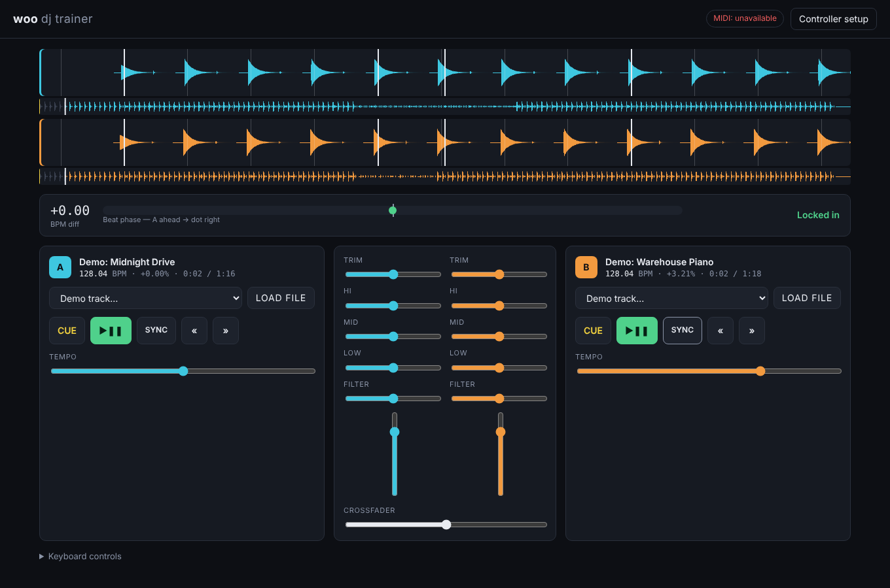

# woo — DJ trainer

A browser app for learning to mix with a real DJ controller (Pioneer DDJ-FLX4, Numark Party Mix / Platinum FX, or any MIDI controller). It's focused on **progressive house, EDM, house and rap**.



## Run it

It's plain HTML/JS with no build step. Serve the folder over HTTP: ES modules and Web MIDI don't work from `file://`.

```bash
npx serve .
```

Then open the printed `localhost` URL in **Chrome or Edge on desktop**. Safari doesn't support Web MIDI. It can also be hosted on GitHub Pages as-is.

## What's in it

- **Two decks** with play/pause, CDJ-style cue, tempo slider (±8%), pitch-bend nudge, jog wheel (bends while playing, scrubs while stopped), and sync.
- **Mixer** with trim, 3-band EQ (with kills), a one-knob filter (low-pass left, high-pass right), channel faders with meters, and an equal-power crossfader.
- **BPM and beat-grid detection** for any audio file you load (drag-and-drop works too).
- **Beatmatch meter** that shows the BPM difference and the beat-phase offset, and tells you whether you're locked in.
- **Genre demo tracks** synthesised in the browser, so there are no licensing issues. They're built from 8-bar phrases (intro / main / breakdown / drop / outro):
  - Progressive House 128 & 124: rolling 16th basslines, pads, arps
  - EDM 128 & 126: big-room kicks, off-beat supersaws, snare-roll builds
  - House 124 & 122: organ bass, piano stabs
  - Rap: boom bap 90, trap 140 (half-time 808s, hat rolls)
- **MIDI learn**: open *Controller setup*, click **Learn**, then move a control. Mappings are saved in the browser and can be exported or imported as JSON. A live MIDI monitor shows exactly what your controller sends.
- **Keyboard fallback**: Deck A `A` play, `S` cue, `D`/`F` nudge, `E`/`R` tempo. Deck B `J`, `K`, `L`/`;`, `I`/`O`. Crossfader `←`/`→`.

## Layout

```
index.html          UI shell
styles.css
src/main.js         wiring: actions, keyboard, MIDI panel, waveforms, beatmatch meter
src/deck.js         audio graph per deck (playback, EQ, filter, faders)
src/bpm.js          offline tempo + beat-phase detection
src/demo-tracks.js  synthesised genre practice tracks
src/midi.js         Web MIDI input + MIDI learn
```

## Next up

- Commit default mappings for the DDJ-FLX4 and Numark controllers, recorded from real hardware with the MIDI monitor
- Lessons and scoring: beatmatch by ear (sync disabled), EQ bass swap, phrase-aligned drops, 128 → 90 tempo transitions for rap sets
- Hot cues and loops
